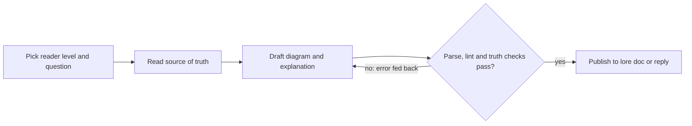

# diagram-skills

Claude Code skills that explain **and** diagram architectures, processes,
decisions, plans and data. Every diagram is Mermaid in Markdown, pitched to
the reader's level, drawn from the real repository, Quest tracker and lore
docs, and checked before it ships: it parses under the Mermaid version
GitHub renders, it follows an accessible profile, and every box traces to a
real source.

## Why

Models write diagram syntax well enough; a parse-and-repair loop fixes most
of the rest. What they get wrong is **truth**. In a 2026 study, node accuracy
was about 0.5–0.67 against edge accuracy of about 0.09–0.18, and models drew
the architecture they expected instead of the one in front of them. No
prior-art diagramming skill checked a diagram against its source or against
its own prose
([research](docs/reference/state-of-the-art-in-diagramming-for-agent-written-docs.md)).

This suite reads before it draws, cites every node, and checks the picture
against the records. It also never ships a diagram without a plain-English
explanation for the reader it was drawn for.

## The skills

| Skill | Answers | Draws from |
|---|---|---|
| `diagram-architecture` | What is this system, and what are its parts? | Repository tree, manifests, compose files, lore docs |
| `diagram-process` | What happens, in what order, and who does it? | Code, runbooks, specs |
| `diagram-decision` | What did we decide, against which options? | ADRs, Quest decisions |
| `diagram-plan` | What blocks what, and where are we? | Quest tasks and milestones (generated) |
| `diagram-data` | What is the shape of the data? | Migrations, DDL, ORM models (generated from DDL) |
| `diagram-review` | Is this diagram valid, legible and true? | The engine; also owns the shared rules |

## How a diagram is made

What does every skill do between a request and a published diagram?



Every skill follows this loop. The question comes first, so each diagram
answers one thing. Reading comes before drawing, so boxes come from records
rather than memory. The three checks loop back with the exact error until
they pass, and the diagram is published only with its explanation.

## Reader levels

The levels follow the plain-english-styles output styles. A skill uses the
level the user names, else the active `plain-english-*` style, else
intermediate.

| | Beginner | Intermediate | Advanced |
|---|---|---|---|
| Node cap | 7 | 12 | 20, then split |
| Labels | Plain words, no ids or jargon | Real names, glossed once | Ids and precise terms |
| Explanation | Conclusion, then one line per unclear box | What it shows and how we know | Claim, mechanism, action |

## The engine

It lives in `skills/diagram-review/scripts/`. The other skills reach it
through `${CLAUDE_SKILL_DIR}/../diagram-review/scripts`.

| Script | Does |
|---|---|
| `mermaid-check.mjs` | Parses every Mermaid fence with `mermaid.parse()` under jsdom, pinned to GitHub's Mermaid (11.17.2). No browser; about 40 ms per diagram |
| `diagram_lint.py` | The profile, `accTitle`/`accDescr`, node caps, a legend wherever colour is used, an explanation next to the fence |
| `diagram_truth.py` | Resolves each node's `%% ref` (path, schema, quest, lore, ext). Generated plans must match Quest's dependencies exactly |
| `quest_graph.py`, `schema_er.py`, `repo_inventory.py` | Generate plan and ER diagrams from records; list a repository's real parts |
| `diagram_export.py` | Opt-in SVG/PNG export through `mmdc`, about 650 MB, installed only on request |

`lore check` never looks inside a Mermaid fence. CI therefore runs these
checks on every pull request, plus a self-test that proves the parser
still fails broken diagrams.

## Install

diagram-skills is listed in the
[opum-marketplace](https://github.com/opum-ai/opum-marketplace), which pins a
release tag:

```text
/plugin marketplace add opum-ai/opum-marketplace
/plugin install diagram-skills@opum
```

The marketplace pin is the v0.1.0 release, which has the skills but not the
[diagram pane](#the-diagram-pane). To get the pane before the pin moves, load
the plugin from a checkout:

```bash
git clone https://github.com/opum-ai/diagram-skills
npm ci --prefix diagram-skills/skills/diagram-review/scripts   # the parse check, about 180 MB, no browser
claude --plugin-dir ./diagram-skills
```

The engine needs Node 20+ and Python 3.9+. Plan diagrams need the
[Quest](https://github.com/opum-ai/quest-cli) CLI; persisting to docs uses
[lore](https://github.com/opum-ai/lore-cli).

## Usage

The skills trigger on ordinary requests:

> I'm new to this repo. Give me an overview of how it fits together, with a diagram for our docs.

> What states can an order go through? Include what happens when payment fails.

> Make a diagram for ADR 0003 showing the options and which one we picked, for the steering group.

> What's still blocking the launch? Show me the dependencies.

> Our CFO isn't technical. Explain what data we keep about customers, with a simple picture.

> Review the diagram in docs/architecture.md before I merge it.

## The diagram pane

A Claude Code mod (`hooks/register.tsx`) draws a Mermaid diagram in a pane:

- `/diagram <path>` draws the first closed `mermaid` fence of a Markdown file,
  or the whole of a `.mmd` or `.mermaid` file.
- The tool `mcp__diagram-skills__show_diagram` (`source`, optional `title` and
  `alt`) lets a skill push its own diagram into the same pane.
- **Syntax gate.** Where `node` is on PATH and jsdom resolves (run `npm ci --prefix
  skills/diagram-review/scripts`, as for the parse check), a source that does
  not parse is refused with Mermaid's own message and the pane keeps what it
  showed. Where it does not, the diagram is drawn as an **unvalidated
  preview**, labelled "Open diagram to check", and the tool result says
  `validated: false`. The gate runs under `node` only; the pane prefers `node`
  over `bun` (bun installs a missing package from the network).

The terminal draws Unicode art when it fits the pane; desktop, VS Code and
mobile draw an SVG. Anything else (a type the renderer does not draw, art wider
or taller than the pane, a source over 20,000 characters, no `bun` or `node` on
`PATH`) keeps the source, says why in one line, and offers an "Open diagram"
button that writes a self-contained HTML page (vendored mermaid.js, strict
security level, no network) and opens it. A file with several diagrams draws up
to 8, with previous and next buttons.

The renderer in `renderer/` is a byte-identical copy of plain-english-styles',
with its licences; see [RENDERER-PROVENANCE.md](RENDERER-PROVENANCE.md).
Transcript rendering of Mermaid fences stays with plain-english-styles.

## Evaluation

Iteration 1 used 12 cases, two per skill, each run once with the skill and
once without (claude-opus-5-5). A grader re-derived the truth from the
fixture's real code, schema and Quest records
([benchmark](evals/benchmarks/iteration-1/benchmark.md),
[notes](docs/stories/evaluation-suite.md)).

| | With skill | Without skill |
|---|---|---|
| Expectations passed | 77 of 77 (100%) | 60 of 77 (78%) |
| Tokens per run | about 39k | about 28k |
| Time per run | about 78 s | about 62 s |

12 of the baseline's 17 failures were missing accessibility fields. The
others were plan views that showed finished or out-of-scope tasks, and
decision diagrams that did not mark or did not draw the options. On this
small fixture the baseline invented no components either, so the truth
checks did not yet separate the two. See Known limitations.

## Repository layout

```text
.claude-plugin/plugin.json    plugin manifest
hooks/                        the diagram pane mod (register.tsx) and its tests
types/                        the pane's state contract
renderer/                     the copied Mermaid renderer, vendored files and licences
.claude/skills/               symlinks to skills/ for local development
.github/workflows/ci.yml      parse, self-test, lint, pytest, lore check, truth
skills/<name>/                SKILL.md, examples/; diagram-review also has references/ and scripts/
evals/                        evals.json, fixtures/, setup_ws.sh, grade.py, benchmarks/
tests/                        pytest for the engine; gate and export self-tests; parser fixtures
docs/                         lore bundle: research, conventions, ADRs, spec, epic, stories
.quest/, .lore/               tracker and lore state
```

## Development

```bash
npm ci --prefix skills/diagram-review/scripts
node skills/diagram-review/scripts/mermaid-check.mjs docs skills README.md
python3 skills/diagram-review/scripts/diagram_lint.py docs skills README.md
python3 skills/diagram-review/scripts/diagram_truth.py --root . docs skills README.md
tests/mermaid_selftest.sh
python3 -m pytest -q
lore check
quest board
```

Evals: build workspaces with `evals/setup_ws.sh <dir>`, run each case with
and without the skill, then `python3 evals/grade.py <run-dir> --eval <id>`.

## Known limitations

- **Truth stops at nodes.** `%% ref` proves each box exists. Edges are
  checked exactly only for generated plan diagrams, and the prose is not
  machine-checked: one with-skill eval answer named the wrong migration
  file for a dropped table.
- **The evals are thin.** One run per arm, one small fixture, and truth
  assertions that did not discriminate. Harder fixtures are needed:
  larger repositories, and stale docs that name removed services.
- **Mermaid's C4 is experimental**, so architecture views are flowcharts
  with C4 classes. Mermaid's layout degrades past about 15 nodes.
- **The Mermaid pin is manual.** When GitHub upgrades, bump
  `skills/diagram-review/scripts/package.json` deliberately.
- **Terminals show source in the transcript.** The Claude Code terminal
  prints a Mermaid fence as text there; the diagram pane draws it as art.
  GitHub, VS Code and JetBrains render it in place.
- **The renderer is lenient.** For some malformed sources the bundled
  renderer draws an empty or partial picture instead of failing. With the
  syntax gate those sources are refused; without it the pane treats an empty
  drawing as a failure and labels any other preview unvalidated.
- **Known gaps queued for iteration 2:**
  - `repo_inventory.py` misses services called by raw URL.
  - `lore query` in a repository without a lore bundle leaves a cache
    directory behind.
  - Beginner ER views still need hand-written plain labels.

## License

MIT AND EPL-2.0 AND BSD-2-Clause. The plugin's own code is MIT
([LICENSE](LICENSE)); the copied renderer carries beautiful-mermaid and mermaid
(MIT), entities (BSD-2-Clause) and the unmodified elkjs file (EPL-2.0). The
licence texts and notices are in [renderer/licenses/](renderer/licenses/).
